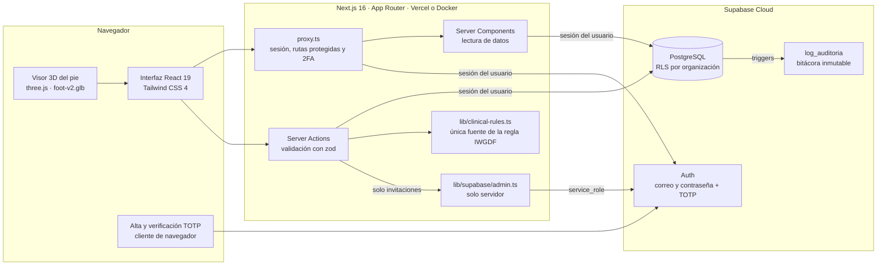
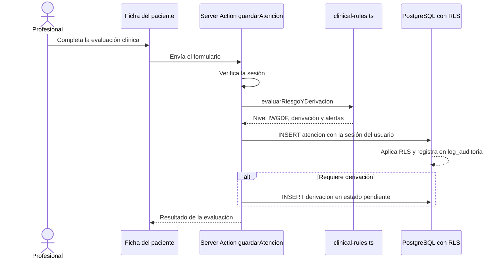
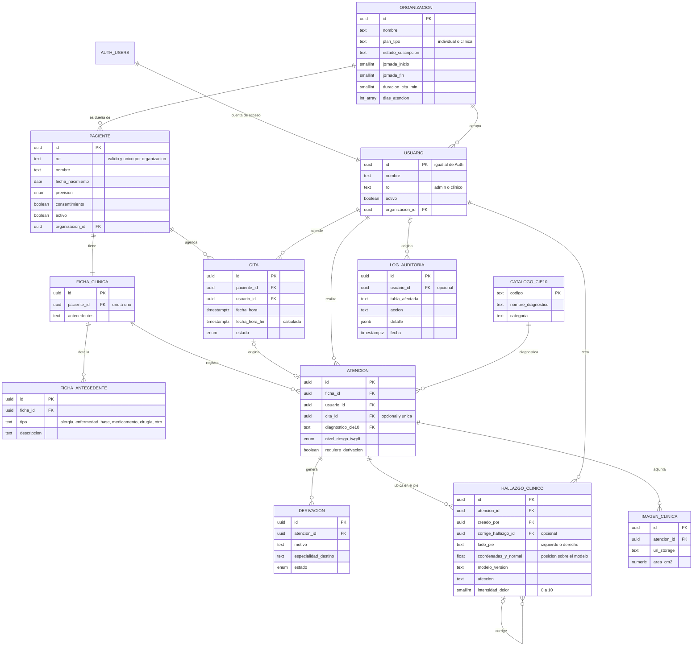

# PodoCare — Sistema de Gestión Clínica para Consultas de Podología


**PodoCare** es una plataforma web de gestión clínica diseñada específicamente para consultas de podología independiente en Chile. Su propósito es digitalizar la ficha clínica del paciente, automatizar el agendamiento de citas, dar seguimiento a las atenciones usando estándares clínicos (CIE-10 e IWGDF) y garantizar la trazabilidad y protección de datos sensibles en cumplimiento con la Ley N.° 19.628 de Protección de la Vida Privada.

Este proyecto se desarrolla en el marco de la asignatura **Capstone (Portafolio de Título)** de la carrera de **Ingeniería en Informática** en **Duoc UC, Sede Plaza Vespucio**.

## Contenido

1. [Contexto y problemática](#contexto-y-problemática)
2. [Funcionalidades](#funcionalidades)
3. [Arquitectura](#arquitectura)
4. [Cómo usa la aplicación a Supabase](#cómo-usa-la-aplicación-a-supabase)
5. [Modelo de datos](#modelo-de-datos)
6. [Seguridad y cumplimiento](#seguridad-y-cumplimiento)
7. [Regla clínica IWGDF](#regla-clínica-iwgdf)
8. [Estructura del repositorio](#estructura-del-repositorio)
9. [Instalación y configuración local](#instalación-y-configuración-local)
10. [Pruebas y CI](#pruebas-y-ci)
11. [Despliegue](#despliegue)
12. [Equipo de trabajo](#equipo-de-trabajo-squad-scrum)
13. [Hitos del proyecto](#hitos-del-proyecto-fases-portafolio)

---

## Contexto y problemática

En Chile, se estima que entre el **60% y el 70% de las consultas de podología independiente** —principalmente negocios unipersonales o equipos de 1 a 2 profesionales— siguen gestionando sus fichas y registros en papel o planillas Excel. Esta práctica informal genera tres problemas concretos:

1. **Pérdida de trazabilidad clínica:** dificultad para hacer seguimiento de tratamientos a largo plazo, como el control de pie de riesgo o la onicocriptosis.
2. **Riesgo operacional y de gestión:** ineficiencias en el agendamiento y la coordinación de citas.
3. **Vulnerabilidad legal:** los datos de salud se clasifican como datos sensibles. Sin almacenamiento seguro ni controles de acceso adecuados, los profesionales quedan expuestos a sanciones bajo la Ley N.° 19.628.

PodoCare resuelve este vacío con un sistema que no trata la seguridad como un añadido, sino como parte de la arquitectura base.

---

## Funcionalidades

| Módulo | Ruta | Qué permite |
|---|---|---|
| **Resumen** | `/dashboard` | Saludo y jornada del día, paciente en sala de espera o próximo, indicadores (citas, derivaciones abiertas, pacientes), seguimiento prioritario y distribución de riesgo IWGDF. |
| **Pacientes** | `/patients` | Búsqueda por nombre o RUT, filtros por grupo de riesgo, alertas, control vencido o sin evaluación, y próximo control de cada paciente. |
| **Ficha clínica** | `/patients/[id]` | Datos y consentimiento informado, atenciones, derivaciones y **mapa clínico del pie en 3D** con hallazgos versionados y correcciones. Permite imprimir la ficha. |
| **Agenda** | `/agenda` | Calendario semanal por profesional, cambio de estado con un toque y bloqueo de doble reserva. |
| **Configuración** | `/configuracion` | Perfil, seguridad (contraseña, verificación en dos pasos, cierre de sesión global) y, para administradores, organización, equipo, ajustes de agenda y registro de actividad. |

Rutas de autenticación:

| Ruta | Descripción |
|---|---|
| `/login` | Inicio de sesión. |
| `/login/verificar` | Segundo paso (código TOTP) cuando la cuenta tiene verificación en dos pasos. |
| `/register` | Creación de cuenta y organización (individual o clínica). |
| `/register/confirm` | Confirmación de correo pendiente. |
| `/recover-password` | Solicitud de recuperación de contraseña. |
| `/update-password` | Cambio de contraseña desde el enlace recibido por correo (también acepta invitaciones). |
| `/auth/confirm` | Callback de Supabase Auth: verifica el token y, en un registro nuevo, crea la organización. |

---

## Arquitectura



| Capa | Responsabilidad | Ubicación |
|---|---|---|
| **Proxy** | Refresca la sesión, redirige a `/login` si no hay usuario y exige el segundo paso cuando corresponde. | `src/proxy.ts` |
| **Server Components** | Leen datos con la sesión del usuario; la base aplica RLS. | `src/app/(dashboard)/**`, `src/features/**` |
| **Server Actions** | Verifican la sesión, validan con zod y escriben en la base. | `src/app/actions/*.ts` |
| **Regla clínica** | Calcula nivel IWGDF, derivación y alertas. Es la única implementación. | `src/lib/clinical-rules.ts` |
| **Validaciones** | Esquemas zod compartidos (RUT, agenda, configuración). | `src/lib/validations/` |
| **Clientes Supabase** | Cliente de servidor, de navegador y de administración. | `src/lib/supabase/` |

---

## Cómo usa la aplicación a Supabase

### Tres clientes, tres propósitos

| Cliente | Archivo | Credencial | Uso |
|---|---|---|---|
| **Servidor** | `src/lib/supabase/server.ts` | Clave pública + cookies de la sesión del usuario | Casi todo: lecturas y escrituras. Respeta RLS. |
| **Navegador** | `src/lib/supabase/client.ts` | Clave pública | Solo la verificación en dos pasos. |
| **Administración** | `src/lib/supabase/admin.ts` | `service_role` (solo servidor) | Únicamente enviar invitaciones por correo. Nunca lee ni escribe tablas clínicas. |

Todas las lecturas y escrituras clínicas se hacen **como el usuario autenticado**, de modo que la base de datos decide qué filas puede ver o modificar.

### Qué tablas toca cada parte

| Parte de la app | Lee | Escribe |
|---|---|---|
| Resumen | `paciente`, `cita`, `derivacion`, `atencion`, `ficha_clinica`, `usuario` | — |
| Pacientes | `paciente`, `ficha_clinica`, `atencion`, `derivacion` | `paciente`, `ficha_clinica` |
| Ficha del paciente | `paciente`, `ficha_clinica`, `atencion`, `derivacion`, `hallazgo_clinico`, `imagen_clinica` | `atencion`, `derivacion`, `hallazgo_clinico` |
| Agenda | `cita`, `paciente`, `usuario` | `cita` |
| Configuración | `usuario`, `organizacion`, `log_auditoria` | `usuario`, `organizacion` (mediante funciones) |

### Funciones de base de datos que la aplicación invoca

| Función (RPC) | Quién la usa | Para qué |
|---|---|---|
| `crear_organizacion_inicial` | Registro | Crea la organización y el usuario administrador, de forma idempotente. |
| `invitar_a_organizacion` | Configuración > Equipo | Asocia a un profesional invitado a la organización del administrador (plan clínica). |
| `admin_actualizar_usuario` | Configuración > Equipo | Cambia el rol o el acceso de un profesional. |
| `admin_actualizar_organizacion` | Configuración | Actualiza el nombre y los ajustes de agenda. |
| `miembros_organizacion` | Configuración > Equipo | Lista al equipo con su correo (leído de Auth). |
| `rut_valido` | Restricción de `paciente` | Valida el RUT con módulo 11. |

### Flujo: registrar una atención



### Flujo: registro e invitación

1. **Registro:** `/register` crea la cuenta en Auth con el plan elegido y envía un correo de confirmación.
2. **Confirmación:** `/auth/confirm` verifica el token y llama a `crear_organizacion_inicial`, que crea la organización y deja al usuario como administrador.
3. **Invitación:** un administrador (plan clínica) envía la invitación desde Configuración. El servidor usa la clave de servicio **solo** para enviar el correo y luego asocia al invitado con `invitar_a_organizacion`, con la sesión del administrador.

---

## Modelo de datos



### Valores controlados

| Tipo | Valores |
|---|---|
| `nivel_riesgo_iwgdf` | `muy_bajo`, `bajo`, `moderado`, `alto` |
| `estado_cita` | `agendada`, `confirmada`, `en_espera`, `atendida`, `cancelada`, `no_asiste` |
| `estado_derivacion` | `pendiente`, `enviada`, `aceptada`, `rechazada`, `completada` |
| `prevision_salud` | `fonasa_a`, `fonasa_b`, `fonasa_c`, `fonasa_d`, `isapre`, `dipreca_capredena`, `particular` |
| `sexo_biologico` | `masculino`, `femenino`, `intersexual`, `no_especificado` |

### Reglas de integridad

| Regla | Descripción |
|---|---|
| **Multi-tenancy** | Cada organización es un tenant. Solo `usuario` y `paciente` guardan `organizacion_id`; el resto de las tablas lo hereda por sus relaciones. |
| **RUT** | Se valida con módulo 11 y es único por organización, sin importar el formato. |
| **Diagnóstico CIE-10** | `atencion` referencia un catálogo; el nombre del diagnóstico vive solo en `catalogo_cie10`. |
| **Sin doble reserva** | Una restricción de exclusión impide citas solapadas de un mismo profesional (se ignoran las canceladas y las no asistidas). |
| **Retención clínica** | Las relaciones entre paciente, ficha, atención, derivación e imagen impiden borrados en cascada; el paciente se da de baja de forma lógica. |
| **Hallazgos inmutables** | No se editan ni se borran. Una corrección es una fila nueva que apunta a la anterior. |
| **Atención ↔ cita** | Una atención puede originarse en una cita, y cada cita origina como máximo una atención. |

> El detalle completo de columnas, políticas y funciones está en [`model.md`](model.md).

---

## Seguridad y cumplimiento

| Medida | Cómo se aplica |
|---|---|
| **Aislamiento por organización** | Row Level Security en todas las tablas clínicas: cada usuario solo ve y modifica filas de su organización, y solo si su cuenta está activa. |
| **Sesión en el servidor** | El proxy valida al usuario en cada solicitud y cada Server Action verifica la sesión antes de escribir. |
| **Validación de entrada** | Los esquemas zod validan los datos antes de llegar a la base de datos. |
| **Verificación en dos pasos** | TOTP opcional por cuenta (Google Authenticator, Microsoft Authenticator…). Con el factor activo, la sesión no accede hasta ingresar el código. |
| **Bitácora inmutable** | Triggers registran cada alta, cambio y baja en tablas clínicas, usuarios y organizaciones. `log_auditoria` no admite `UPDATE` ni `DELETE`. |
| **Secretos** | La clave `service_role` vive solo en variables de entorno del servidor y solo se usa para invitaciones. No se versiona ningún `.env`. |
| **Funciones sensibles** | Las funciones de administración validan `auth.uid()` y el rol dentro de la propia función. |

### Permisos por rol

| Acción | `admin` | `clinico` |
|---|:---:|:---:|
| Ver, crear y editar pacientes | ✔ | ✔ |
| Registrar atenciones, hallazgos y derivaciones | ✔ | ✔ |
| Gestionar la agenda | ✔ | ✔ |
| Editar su perfil y su seguridad | ✔ | ✔ |
| Organización y plan | ✔ | — |
| Equipo (roles, acceso e invitaciones) | ✔ | — |
| Ajustes de agenda | ✔ | — |
| Registro de actividad | ✔ | — |

El **plan individual** crea una organización con un solo profesional y no permite invitar. El **plan clínica** agrupa a varios profesionales que comparten pacientes, agenda y atenciones.

---

## Regla clínica IWGDF

Toda la lógica de clasificación vive en [`src/lib/clinical-rules.ts`](src/lib/clinical-rules.ts) y es la única fuente de verdad. La interfaz y las acciones del servidor la importan; nunca la reimplementan.

**Entradas de la evaluación:** sensibilidad al monofilamento, pulsos pedios, deformidad, úlcera o amputación previa, signos de infección y dolor isquémico.

| Condición | Resultado |
|---|---|
| Signos de infección activa | Derivación y **bloqueo de procedimientos invasivos** |
| Pulsos ausentes o dolor isquémico | Sospecha de isquemia: derivación y **bloqueo de procedimientos invasivos** |
| Úlcera o amputación previa | Grupo 3 · **Alto** y derivación |
| Sin sensibilidad y (sin pulsos o con deformidad) | Grupo 2 · **Moderado** |
| Sin sensibilidad o sin pulsos | Grupo 1 · **Bajo** |
| Ninguna de las anteriores | Grupo 0 · **Muy bajo** |

**Control sugerido por grupo:**

| Grupo | Nivel | Frecuencia |
|---|---|---|
| 0 | Muy bajo | Cada 12 meses |
| 1 | Bajo | Cada 6 a 12 meses |
| 2 | Moderado | Cada 3 a 6 meses |
| 3 | Alto | Cada 1 a 3 meses |

La aplicación calcula con estas frecuencias el próximo control de cada paciente y marca como vencido el que supera el máximo de su grupo.

---

## Estructura del repositorio

```text
.
├── src/
│   ├── app/                  Rutas (App Router)
│   │   ├── (dashboard)/      Resumen, pacientes, agenda y configuración
│   │   ├── actions/          Server Actions
│   │   ├── auth/confirm/     Callback de Supabase Auth
│   │   └── login, register…  Pantallas de autenticación
│   ├── components/common/    Botón, tarjeta, campo, alerta, íconos, insignia de riesgo
│   ├── features/             Componentes por dominio (agenda, auth, configuración, pacientes)
│   ├── layouts/              Estructura del panel y de la autenticación
│   ├── lib/
│   │   ├── clinical-rules.ts Regla clínica IWGDF
│   │   ├── estado-clinico.ts Estado clínico por paciente (riesgo, control, alertas)
│   │   ├── agenda.ts         Fechas y zona horaria de Santiago
│   │   ├── supabase/         Clientes de servidor, navegador y administración
│   │   └── validations/      Esquemas zod
│   └── proxy.ts              Sesión, rutas protegidas y segundo paso
├── public/models/            Modelo 3D del pie (foot-v2.glb)
├── scripts/                  Generación del modelo 3D
├── .github/                  CI, plantillas y guías del equipo
├── docker-compose.yml        Ejecución en contenedor
└── model.md                  Detalle del modelo de datos y de las políticas
```

---

## Instalación y configuración local

### Requisitos previos

- Node.js 22.18 o superior (el CI usa la serie 22.x; Next.js 16 requiere 20.9 o superior).
- Docker Desktop con Docker Compose, si se ejecutará en contenedor.
- Un proyecto de Supabase con el esquema aplicado (ver [Base de datos](#base-de-datos)).

### Pasos

1. **Clonar el repositorio:**
   ```bash
   git clone https://github.com/MarceloCaballeroo/CAPSTONE.git
   cd CAPSTONE
   ```

2. **Configurar las variables de entorno.** Copia `.env.example` como `.env` en la raíz del proyecto:

   ```bash
   # Bash
   cp .env.example .env
   ```
   ```powershell
   # PowerShell
   Copy-Item .env.example .env
   ```

   | Variable | Obligatoria | Descripción |
   |---|:---:|---|
   | `NEXT_PUBLIC_SUPABASE_URL` | Sí | URL del proyecto de Supabase. |
   | `NEXT_PUBLIC_SUPABASE_ANON_KEY` | Sí | Clave pública (apta para el navegador). |
   | `NEXT_PUBLIC_SITE_URL` | Recomendada | URL pública del sitio, usada en los enlaces de los correos. Por ejemplo `http://localhost:3000`. |
   | `SUPABASE_SERVICE_ROLE_KEY` | No | Clave de servicio. **Solo servidor y sin prefijo `NEXT_PUBLIC_`.** Habilita invitar profesionales. |

   Agrega `NEXT_PUBLIC_SITE_URL` a las URLs de redirección permitidas en **Authentication → URL Configuration** del panel de Supabase.

3. **Ejecutar en modo desarrollo:**

   ```bash
   npm ci
   npm run dev
   ```

   Abre [http://localhost:3000](http://localhost:3000).

4. **Ejecutar con Docker (alternativa):**

   El contenedor ejecuta Next.js y se conecta al proyecto remoto de Supabase; no se levanta un PostgreSQL local.

   ```bash
   docker compose --env-file .env up --build       # primer plano
   docker compose --env-file .env up --build -d    # segundo plano
   docker compose down                              # detener
   ```

   > `docker-compose.yml` solo entrega al contenedor las dos variables públicas de Supabase. Si necesitas invitar profesionales desde el contenedor, agrega también `SUPABASE_SERVICE_ROLE_KEY`.

### Base de datos

El esquema (tablas, políticas RLS, funciones y triggers) vive en el proyecto de Supabase y **no se versiona en este repositorio**, porque describe información sensible de la base. Para levantar un entorno nuevo, solicita el script de esquema al responsable de datos del equipo.

La aplicación espera encontrar:

- Las tablas y tipos descritos en [Modelo de datos](#modelo-de-datos).
- Las funciones listadas en [Funciones de base de datos que la aplicación invoca](#funciones-de-base-de-datos-que-la-aplicación-invoca).
- Triggers de auditoría sobre las tablas clínicas, `usuario` y `organizacion`, y la bitácora `log_auditoria` inmutable.
- Row Level Security activo en todas las tablas.

### Comandos útiles

| Comando | Descripción |
|---|---|
| `npm run dev` | Servidor de desarrollo. |
| `npm run lint` | Análisis estático con ESLint. |
| `npm run build` | Compilación de producción. |
| `npm start` | Sirve la compilación de producción. |
| `node --test "src/**/*.test.mjs"` | Pruebas unitarias. |

---

## Pruebas y CI

Las pruebas usan el ejecutor integrado de Node (`node:test`) e importan los módulos TypeScript directamente.

| Prueba | Qué cubre |
|---|---|
| `src/lib/agenda.test.mjs` | Semana, zona horaria de Santiago y rangos de consulta. |
| `src/lib/clinical-rules.test.mjs` | Frecuencias de control y lectura de alertas bloqueantes. |
| `src/lib/validations/configuracion.test.mjs` | Validación de los ajustes de agenda. |
| `src/lib/types/hallazgos.test.mjs` | Hallazgos vigentes y correcciones. |

El flujo de integración continua (`.github/workflows/ci.yml`) se ejecuta en cada *push* y *pull request* hacia `main`:

1. Instala dependencias con `npm ci`.
2. Ejecuta el linter.
3. Compila Next.js.
4. Valida la imagen Docker.

---

## Despliegue

- **Frontend:** Vercel, con las variables de entorno de la tabla anterior configuradas para *Production* y *Preview*.
- **Backend:** Supabase Cloud.
- **Correos de invitación:** en **Authentication → Email Templates → Invite user**, el enlace debe apuntar a `/auth/confirm` con `type=invite` y `next=/update-password`.
- **Variable de servicio:** `SUPABASE_SERVICE_ROLE_KEY` debe guardarse como secreto del servidor y nunca exponerse al navegador.

---

## Equipo de trabajo (Squad Scrum)

El proyecto se desarrolla con la metodología ágil **Scrum**, con roles distribuidos así:

| Integrante | Rol Scrum | Responsabilidades |
|---|---|---|
| **Marcelo Ignacio Caballero Olave** | Developer — Seguridad, Datos e Infraestructura | Modelado físico de la base de datos PostgreSQL, políticas RLS, triggers de auditoría, integración de Supabase (Auth) y despliegue en Vercel/Docker. |
| **Martin Antonio Maldonado Astudillo** | Developer — Frontend y QA | Desarrollo del cliente web en Next.js, implementación de UI/UX y control de calidad. |
| **Emily Catalina Vera Gutiérrez** | Scrum Master / Product Owner | Gestión del backlog, documentación de requerimientos y coordinación directa con el cliente real (podólogo independiente). |

---

## Hitos del proyecto (fases Portafolio)

1. **Fase 1 — Definición y diseño** *(semanas 1-4):* levantamiento de requerimientos con el cliente, modelado de la base de datos relacional y diseño de políticas RLS.
2. **Fase 2 — Desarrollo e implementación** *(semanas 5-12):* implementación iterativa en sprints de 2 semanas de los módulos de autenticación, agenda, ficha clínica, mapa del pie y bitácora de auditoría.
3. **Fase 3 — Validación, cierre y entrega** *(semanas 13-18):* despliegue del sistema, pruebas de usabilidad y funcionales con el usuario real, y elaboración del informe final de título.
